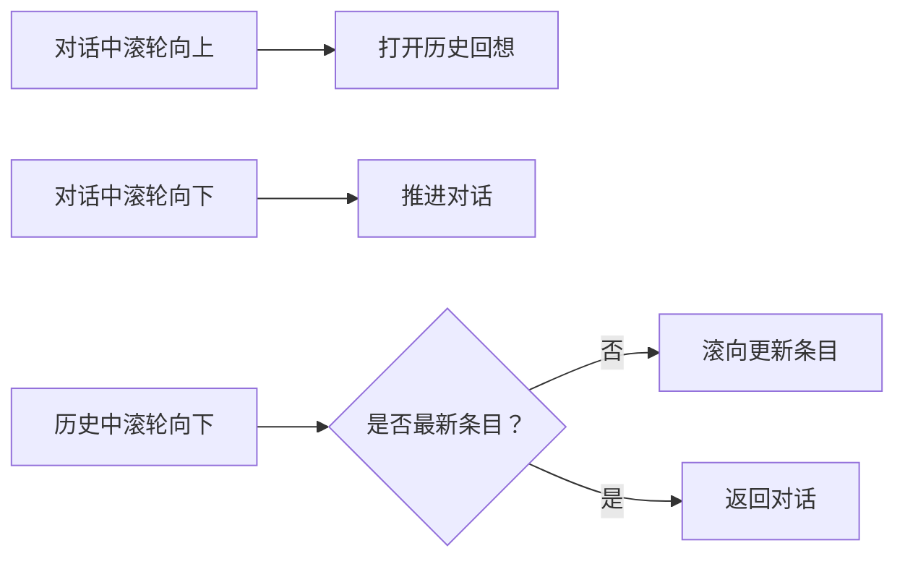

# KirikiriLike - Ren'Py 的 KiriKiri 风格 UI

[](https://www.renpy.org/)
[](LICENSE)
[](https://github.com/ThanhNhanGit/KirikiriLike/stargazers)
[](https://github.com/ThanhNhanGit/KirikiriLike/commits/master)

**KirikiriLike** 是一个可直插使用的 Ren'Py 8 库，可提供熟悉的
[KiriKiri/KAG](https://en.wikipedia.org/wiki/KiriKiri) 风格视觉小说控件与 UI 行为。
把一个文件夹复制进游戏，即可获得鼠标滚轮对话控制、简洁的回想，以及左下角角色头像，
无需在每个项目中反复修改 `screens.rpy`。

KirikiriLike 是独立的社区项目。它不隶属于 KiriKiri/KAG 项目或 Ren'Py 项目，也不受其赞助或背书。
KiriKiri 和 KAG 名称仅用于描述 UI 灵感来源；不包含任何 KiriKiri/KAG 源代码或资源。

## 功能

- **滚轮向上打开对话回想**，而不是回滚。
- **滚轮向下推进对话**，与 KiriKiri 视觉小说类似。
- **简洁的历史界面**，没有 Ren'Py 左侧游戏菜单导航或分隔线。
- **在历史中向下滚动会滚向最新条目**，然后返回底部的实时对话。
- **角色侧图头像**跟随当前显示的立绘属性。
- **可选的玻璃渐变文本框模板**，附带内置 Nunito 对话字体。
- **可复用的配置命名空间**——通过 `kkl.*` 设置自定义行为。
- **默认仍保留回滚功能**，可通过键盘/Page Up 使用。
- **无需修补 Ren'Py 引擎**，也无需按项目复制/粘贴界面代码。

## 快速开始

下载本仓库，并将文件夹放到此处：

```text
your-game/
└── game/
    └── KirikiriLike/
        ├── 00_kirikirilike_config.rpy
        ├── 10_kirikirilike_core.rpy
        ├── 20_kirikirilike_wheelnav.rpy
        ├── 30_kirikirilike_history.rpy
        ├── 40_kirikirilike_textbox.rpy
        ├── fonts/
        └── gui/
```

Ren'Py 会自动加载 `game/` 下的 `.rpy` 文件；无需 import 语句。

如果使用 Git，可以通过子模块让库更易更新：

```bash
git submodule add https://github.com/ThanhNhanGit/KirikiriLike.git game/KirikiriLike
```

## 配置库

在项目中创建 `game/kkl_settings.rpy`：

```renpy
init python:
    # 这些选项默认即为 True；此处仅作说明。
    kkl.enable_wheelnav = True
    kkl.history_closes_on_wheeldown = True

    # 可选：半透明底部渐变 + Nunito 对话文字。
    kkl.enable_textbox_template = True
```

请在默认 init 优先级（`0`）或任何低于 `100` 的优先级下设置选项。不要编辑
库文件；这样可在 Ren'Py 项目之间保持升级可移植。

### 可用设置

| 设置 | 默认值 | 用途 |
|---|---:|---|
| `kkl.enable_wheelnav` | `True` | 滚轮向上打开历史；滚轮向下推进对话。 |
| `kkl.enable_side_image` | `True` | 允许可选的固定标签侧图覆盖。 |
| `kkl.enable_textbox_template` | `False` | 应用内置玻璃渐变文本框和 Nunito 样式。 |
| `kkl.side_image_tag` | `None` | 保持 `None` 可让头像感知说话人；仅在每行都固定同一头像时才设置标签。 |
| `kkl.wheel_up_key` | `"mousedown_4"` | 打开对话回想的输入。 |
| `kkl.wheel_down_key` | `"mousedown_5"` | 推进对话或关闭历史的输入。 |
| `kkl.history_closes_on_wheeldown` | `True` | 在历史中滚动到最新条目后继续向下时返回游戏。 |
| `kkl.history_use_project_styles` | `True` | 复用项目自带的历史和游戏菜单样式。 |
| `kkl.textbox_background` | 内置 SVG | 分辨率无关的文本框渐变图像或 displayable。 |
| `kkl.textbox_feather_edges` | `True` | 柔和淡化面板全部四条边和四个角。 |
| `kkl.textbox_background_opacity` | `1.0` | 渐变面板透明度乘数。 |
| `kkl.textbox_font` | Nunito Regular | 对话字体路径或 `FontGroup`。 |
| `kkl.textbox_name_font` | Nunito SemiBold | 说话人姓名字体路径或 `FontGroup`。 |
| `kkl.textbox_text_color` | `"#f7f9fc"` | 对话文字颜色。 |
| `kkl.textbox_name_color` | `"#ffffff"` | 默认说话人姓名颜色；Character 颜色仍可覆盖它。 |
| `kkl.textbox_text_outlines` | 轻微阴影 + 1px 描边 | 在不撑胀字形的前提下提供对话层次与可读性。 |
| `kkl.textbox_name_outlines` | 轻微阴影 + 1px 描边 | 在不撑胀字形的前提下提供姓名层次与可读性。 |
| `kkl.textbox_namebox_background` | `None` | 姓名框背景；`None` 会移除独立铭牌。 |
| `kkl.textbox_on_small` | `True` | 也将模板应用到 small/mobile 变体。 |
| `kkl.force_rollback_disabled` | `False` | 启用后完全禁用 Ren'Py 回滚。 |

## 启用玻璃渐变文本框模板

文本框样式为可选启用，这样把 KirikiriLike 加入现有游戏时，不会意外替换其美术风格。
在项目设置中启用：

```renpy
init python:
    kkl.enable_textbox_template = True
```

该模板保留项目现有的文本框高度、对话位置和文本宽度。它会把标准 say 窗口背景替换为
可见的半透明面板，边缘柔和羽化，并带有平滑的由上至下渐变；对话应用 Nunito Regular，
说话人姓名应用 SemiBold；移除独立姓名铭牌；并在细窄居中描边后方添加可见但克制的两像素
向下阴影，同时不扭曲字形。

SVG 渐变及其水平/垂直 alpha 遮罩会由 Ren'Py 的 `Frame` displayable 拉伸到实际文本框
分配区域。同时乘算两个遮罩即可羽化四条边和四个角，使面板没有方形边界。左、右、下遮罩
在视口边界仍部分可见，让它们的衰减延伸到被裁剪屏幕之外，而不是留下透明沟槽。
当项目更改分辨率或文本框高度时，它会一致缩放；无需硬编码 `1280x720` 布局。

只自定义你需要的部分：

```renpy
init python:
    kkl.enable_textbox_template = True
    kkl.textbox_background_opacity = 0.85
    kkl.textbox_text_color = "#ffffff"
    kkl.textbox_text_outlines = [(0, "#00000066", 0, 2), (1, "#000000c0", 0, 0)]
    kkl.textbox_namebox_background = Frame("gui/my_namebox.png", 12, 12)
```

每个描边图层都使用 Ren'Py 的 `(thickness, color, x_offset, y_offset)` 格式。
厚度为 `0` 时，会从原始字形创建阴影而不会扩张字形。默认 2px 偏移会让阴影越过
居中的 1px 描边一像素；将任一描边列表设为 `[]` 可移除所有文字效果。

字体设置也接受 Ren'Py 的 `FontGroup`，当翻译需要 Nunito 覆盖范围之外的字符时很有用。
如果内置字体或渐变文件不可用，模板会回退到 `DejaVuSans.ttf` 和半透明纯色背景，
而不是在启动时失败。

## 添加角色侧图头像

KirikiriLike 使用 Ren'Py 内置的 `SideImage()` 系统。项目需要提供角色定义和头像立绘。

### 1. 给角色一个 image 标签

```renpy
define s = Character("Sylvie", image="sylvie")
```

### 2. 定义与立绘属性匹配的侧图

```renpy
image side sylvie green normal = "images/side/side sylvie green normal.png"
image side sylvie green smile = "images/side/side sylvie green smile.png"
image side sylvie green surprised = "images/side/side sylvie green surprised.png"
```

这就是全部所需配置。保持 `kkl.side_image_tag = None`（默认值）。
头像只会在 `s` 说话时跟随 Sylvie 显示的属性；旁白或其他角色说话时不会出现 Sylvie 头像。
如果不存在匹配的 `side sylvie ...` 图像，Ren'Py 不会显示头像，也不会报错。

设置 `kkl.side_image_tag = "sylvie"` 是高级的固定标签覆盖。它会刻意在每一行都跟随
Sylvie 显示的立绘，包括旁白，因此不应用于普通说话人头像。

Ren'Py 自带 `say` 界面可能会用 `xoffset 20` 和 `yoffset -20` 内缩头像。
要让头像紧贴屏幕左下角边框，请移除这些偏移：

```renpy
add SideImage() xalign 0.0 yalign 1.0
```

## 鼠标滚轮行为如何工作



滚轮向上的绑定位于一个常开 overlay 中，会在 Ren'Py 默认回滚处理器之前捕获事件。
历史界面负责自己的滚轮向下行为，因为菜单打开时普通 overlay 界面会被抑制；
它会滚向更新条目，仅在底部时退出。

## 兼容性

- 面向使用标准界面架构的 **Ren'Py 8.x** 项目设计。
- 文本框模板面向标准 `window`、`namebox`、`say_dialogue`、
  `say_thought` 和 `say_label` 样式。自定义 Character 样式名或自定义 say 界面
  必须继承或使用这些样式，才能应用模板。
- 历史样式被重度定制的项目可设置 `kkl.history_use_project_styles = False`
  来使用内置回退样式。
- 移动端变体不使用鼠标滚轮导航；侧图行为仍遵循项目的 `say` 界面和变体规则。

## 故障排除

### 头像不出现

检查这些要求：

1. `Character` 具有 `image="..."`。
2. 存在匹配的 `image side <tag> <attributes>`。
3. 对于感知说话人的行为，`kkl.side_image_tag` 保持为 `None`。

添加新图像文件后请重启 Ren'Py，让图像扫描器能发现它们，或按上文所示显式定义图像。

### 滚轮向上仍执行回滚

确认 `kkl.enable_wheelnav` 为 `True`，并确认没有另一个高 z-order 界面抢先捕获
`mousedown_4`。

### 恢复 Ren'Py 自带历史界面

删除 `30_kirikirilike_history.rpy`。其余滚轮和侧图功能可继续保留安装。

### 恢复项目原始文本框

设置 `kkl.enable_textbox_template = False`，或删除 `40_kirikirilike_textbox.rpy`。由于该
功能不会替换 `screen say`，因此无需恢复任何界面代码。

## 项目文件

| 文件 | init 优先级 | 用途 |
|---|---:|---|
| `00_kirikirilike_config.rpy` | `-100` / `-1` | 声明 `kkl` 命名空间和默认值。 |
| `10_kirikirilike_core.rpy` | `100` | 配置侧图和可选的回滚禁用。 |
| `20_kirikirilike_wheelnav.rpy` | `150` | 捕获滚轮向上，并添加滚轮向下推进对话。 |
| `30_kirikirilike_history.rpy` | `999` | 用简洁的回想替换自带历史界面。 |
| `40_kirikirilike_textbox.rpy` | `105` / `110` | 应用可选渐变和文本框字体样式。 |

## 测试

本库已通过 Ren'Py 8.5 原生测试用例进行 lint 和实测。测试覆盖对话推进、历史返回行为、
导航移除、侧图解析、字体应用，以及文本框渐变的 alpha 曲线。还检查了未激活游戏窗口时
真实后台鼠标滚轮事件。

如需可复用的 Ren'Py lint、路由测试、UI 断言和截图回归，请参阅
[test-renpy-vn](https://github.com/ThanhNhanGit/test-renpy-vn)。

## 贡献

欢迎在 [GitHub Issues](https://github.com/ThanhNhanGit/KirikiriLike/issues) 提交错误报告和兼容性说明。
请尽可能附上你的 Ren'Py 版本、平台、相关 `kkl` 设置，以及最小复现步骤。

亦欢迎在 [GitHub Issues](https://github.com/ming6293/KirikiriLike-zh_cn/issues) 报告翻译错误和因翻译造成的bug。

## 许可与署名

KirikiriLike 基于 [MIT License](LICENSE) 发布。历史实现改进了 Ren'Py MIT 许可
自带历史界面的结构。内置 Nunito 文件仍遵循 SIL Open Font License 1.1。保留的 Ren'Py
许可说明、字体署名、许可声明和项目名称披露见
[THIRD_PARTY_NOTICES.md](THIRD_PARTY_NOTICES.md)。

## 相关文档

- [Ren'Py side images](https://www.renpy.org/doc/html/side_image.html)
- [Ren'Py dialogue history](https://www.renpy.org/doc/html/history.html)
- [Ren'Py screen language](https://www.renpy.org/doc/html/screens.html)
